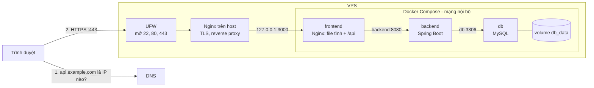

# ProPTIT Guestbook — dự án thực hành deploy

Dự án **Frontend + Backend + Database** nhỏ gọn để thực hành **Buổi 12: Quy trình deploy cơ bản** (VPS, SSH, Docker, Firewall, DNS, Nginx, HTTPS).

Ứng dụng là một **sổ lưu bút**: ai vào trang cũng có thể để lại lời nhắn. Điểm đặc biệt là trang có bảng **"Hành trình của request"**: tự kiểm tra từng tầng (tên miền → HTTPS → Nginx → Spring Boot → MySQL) mỗi 5 giây. Tầng nào chưa đạt sẽ chuyển màu vàng hoặc đỏ kèm gợi ý lệnh xử lý, nên vừa deploy vừa **nhìn thấy** được từng kiến thức đã học.

| Thành phần | Công nghệ |
|---|---|
| Frontend | HTML + CSS + JavaScript thuần (không cần build), phục vụ bởi Nginx trong container |
| Backend | Spring Boot 3.5, Java 21, Spring Data JPA, Actuator |
| Database | MySQL 8 (prod) / H2 trong bộ nhớ (dev) |
| Hạ tầng | Docker, Docker Compose, Nginx trên host, Certbot (Let's Encrypt) |

## Kiến trúc



- Từ Internet chỉ vào được qua **Nginx trên host** (port 80/443).
- `frontend` chỉ bind `127.0.0.1:3000`, `backend` chỉ bind `127.0.0.1:8080` (để `curl` kiểm tra trên VPS), còn `db` **không publish port nào**.
- Các container gọi nhau bằng **tên service** (`backend`, `db`) qua DNS nội bộ của Docker.
- Frontend gọi API bằng đường dẫn tương đối `/api/...` nên FE và API **cùng origin**, không cần CORS.

## Kiến thức trong bài ↔ chỗ thể hiện trong dự án

| Kiến thức (Buổi 12) | Thể hiện ở đâu | Nhìn thấy trên trang |
|---|---|---|
| Tách cấu hình khỏi mã nguồn, profile dev/prod | `application.yml`, `application-dev.yml`, `application-prod.yml`, `.env.example` | Backend hiện `profile prod` |
| Dockerfile multi-stage, chạy bằng user thường | `backend/Dockerfile` | Java 21 trong container |
| Image / Container | Mỗi lần deploy lại là một container mới | `container 786854f5dd8f` đổi sau mỗi lần `up --build` |
| Docker Compose, mạng nội bộ, gọi bằng tên service | `docker-compose.yml` (`jdbc:mysql://db:3306`, `proxy_pass http://backend:8080`) | Database hiện URL `jdbc:mysql://db:3306/guestbook` |
| Volume giữ dữ liệu | `db_data:/var/lib/mysql` | Lời nhắn vẫn còn sau khi tạo lại container hoặc reboot |
| `depends_on` + `healthcheck`, `restart: unless-stopped` | `docker-compose.yml` | Tự chạy lại sau `sudo reboot` |
| IP, Port, `127.0.0.1` và `0.0.0.0` | `PUBLISH_IP` trong `.env` | Tầng Nginx báo vàng khi còn vào thẳng port 3000 |
| Firewall (UFW) | `DEPLOY.md` Lab 1, Lab 4 | — |
| DNS, bản ghi A | `DEPLOY.md` Lab 4 | Tầng Tên miền: vàng khi dùng IP, xanh khi dùng tên miền |
| Reverse proxy, header `X-Forwarded-*` | `deploy/nginx/guestbook.conf`, `frontend/nginx.conf`, `server.forward-headers-strategy` | "Backend nhìn thấy bạn: IP …, giao thức https" |
| HTTPS với Let's Encrypt | `DEPLOY.md` Lab 4 | Tầng HTTPS chuyển xanh |
| Cập nhật phiên bản | `APP_VERSION` trong `.env` | Phiên bản hiển thị trên trang thay đổi |
| Xử lý sự cố từ trong ra ngoài | `DEPLOY.md` Lab 5 | Tầng lỗi chuyển đỏ kèm lệnh chẩn đoán |

## Chạy ở máy cá nhân

**Cách 1: bằng Docker (giống hệt trên VPS)**, cần Docker Desktop:

```bash
cp .env.example .env
docker compose up -d --build
# Mở http://localhost:3000
docker compose logs -f backend      # xem log
docker compose down                 # dừng (giữ dữ liệu); thêm -v để xoá cả dữ liệu
```

**Cách 2: chỉ chạy backend** (profile `dev`, dùng H2, không cần MySQL), cần JDK 21 và Maven:

```bash
cd backend
mvn spring-boot:run
# http://localhost:8080/api/info
```

## API

| Method | Đường dẫn | Mô tả |
|---|---|---|
| GET | `/api/info` | Phiên bản, profile, container, IP/giao thức client mà backend thấy, trạng thái database |
| GET | `/api/messages` | 50 lời nhắn mới nhất |
| POST | `/api/messages` | Tạo lời nhắn: `{"author": "Tên", "content": "Nội dung"}` |
| GET | `/actuator/health` | Health check (chỉ gọi được trên VPS: `curl localhost:8080/actuator/health`) |

## Deploy lên VPS

Xem hướng dẫn từng bước trong **[DEPLOY.md](DEPLOY.md)**.

## Cấu trúc thư mục

```
.
├── docker-compose.yml        # 3 service: db, backend, frontend
├── .env.example              # mẫu biến môi trường (copy thành .env, không commit .env)
├── backend/
│   ├── Dockerfile            # multi-stage: Maven build -> JRE runtime
│   ├── pom.xml
│   └── src/main/
│       ├── java/com/proptit/guestbook/
│       │   ├── info/InfoController.java        # /api/info
│       │   └── message/...                     # /api/messages
│       └── resources/application*.yml          # profile dev / prod
├── frontend/
│   ├── Dockerfile            # nginx:alpine + file tĩnh
│   ├── nginx.conf            # phục vụ file tĩnh, proxy /api -> backend:8080
│   └── public/               # index.html, app.js, style.css
└── deploy/
    └── nginx/guestbook.conf  # cấu hình Nginx trên host (reverse proxy + certbot)
```

## Bài tập mở rộng

1. Build image ở máy cá nhân hoặc bằng GitHub Actions, đẩy lên GHCR; trên VPS dùng `image:` thay cho `build:`.
2. Viết workflow GitHub Actions tự `git pull && docker compose up -d --build` qua SSH khi push lên `main`.
3. Giám sát `https://<DOMAIN>/api/info` bằng Uptime Kuma hoặc UptimeRobot.
4. Viết script `mysqldump` sao lưu database hằng ngày bằng `cron`.
5. Deploy cùng dự án lên Render hoặc Railway và so sánh với VPS.
